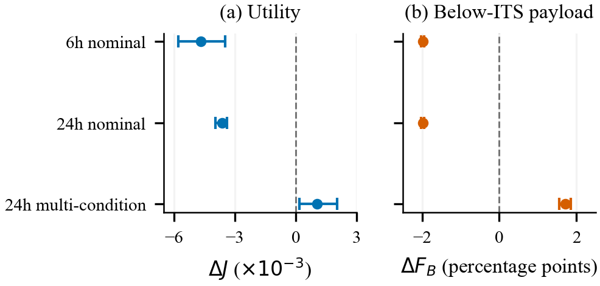
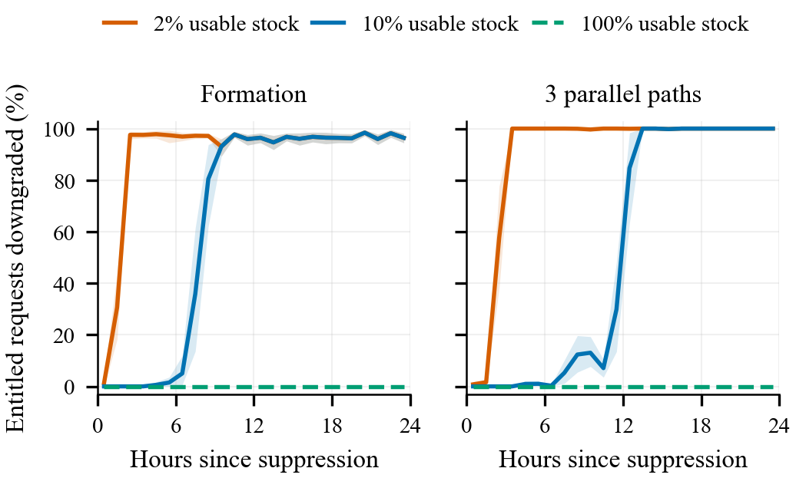

# Understanding this research from the beginning

This guide explains the problem, the model, and the evidence in this repository without assuming knowledge of quantum communication, cryptography, networking, or machine learning. It describes what the code represents and what the results can support. Older drafts are research history, not automatically reliable descriptions of the current implementation.

## What this study establishes

The central question is a practical one: when a network cannot supply the kind of secret key requested by an application, should it refuse the request or supply a different kind of key and record that change? This guide explains the completed simulation studies and the assumptions behind their answers. It introduces the technical terms before interpreting the numerical comparisons.

The main finding is conditional. Previously accepted stored key can keep a network operating after production stops, provided that the key is still safe and the required communication path works. Once the usable supply is inadequate, refusing service and accepting a lower assurance grade produce different kinds of loss. A learned controller can slightly improve an average service score while worsening the outcome for an important traffic class. Those are model results, not demonstrations that messages were decrypted or that a deployed network is secure.

The revision corrects several earlier ambiguities. The original function named `formation_9node()` builds eight nodes and nine links. Each forward post has only one connecting edge, although separating all forward posts requires two suitable edges. The old routing rule suspended quantum-key delivery as soon as generation stopped, even with unused stock. The revised scenarios distinguish stored-key retention from a deliberate purge, and generation failure from loss of the ordinary communication path. Values from `RESULTS.md`, earlier reviews, and the old abstract belong to their historical configuration and must not be mixed with the revised results.

## The practical question

Imagine several communication sites connected by links. Applications ask the network for secret keys so they can protect messages. The network can make new keys on some links, store unused keys, and relay keys through intermediate sites. Demand can arrive faster than a difficult link can replenish its store.

An application may require one particular method of key delivery. When that method cannot be provided, the network has a policy decision. Under **fail-closed**, it waits within the request's allowed time and then refuses service. Under **fail-degraded**, it may supply a grade below the application's requested floor and record a violation. In this study, the grade change is an observable simulation event, not evidence that a real operator would or would not notice it.

The choice trades different things. Refusing a request sacrifices availability. Serving below its floor sacrifices compliance with that assurance requirement, even if the fallback still uses a computationally secure cryptographic method. Neither result means that the attacker has decrypted a message. The study asks how those outcomes change with demand, available key, network paths, and modeled disruption.

The implementation of the main decision is `_serve_or_wait()` in [qkdsim/sim.py](../../qkdsim/sim.py). The final revised manuscript is [paper.tex](../../paper.tex). The [archived original source](../../archive/manuscripts_before_revision/paper.tex) remains separate. The completed experiment reports, rather than an old draft's prose, establish which numerical claims were verified.

In the simulation, a served session means that its key-supply or admission request succeeded within the allowed time. The code does not transmit the associated payload, simulate its bandwidth or packet losses, or execute its cipher. A successful request therefore does not demonstrate actual voice-call quality or message throughput. Payload-weighted loss counts the data associated with affected requests as an exposure proxy; it is not a measurement of data transmitted or secrets disclosed. The assumed G3/G4 setup delay is also not a measured cryptographic benchmark.

## What a key is, and why encryption needs one

A bit is a binary digit, either zero or one. A cryptographic key is a secret sequence of bits used by an encryption method. Encryption transforms a readable message into protected data; the receiver uses the appropriate key to recover the message. The message itself is called the payload.

A symmetric cipher uses a shared secret key. AES is an example. A short AES key can protect much more data than its own length, subject to the cipher's operating rules. Its security is computational: it relies on the difficulty of carrying out particular calculations, together with a correct implementation and correct key handling.

A one-time pad, abbreviated OTP, uses a uniformly random secret pad at least as long as the protected bit string, used only once. Under its assumptions it provides information-theoretic confidentiality: the encrypted message does not reveal the plaintext even to an adversary with unlimited computation. Reusing the pad or exposing it breaks those assumptions. Authentication is still needed to detect message tampering.

This explains why payload size and key size must not be confused. Protecting a 144,000-bit payload with an OTP needs 144,000 fresh pad bits. A modeled AES rekey may need only a 256-bit secret key. The second method is far cheaper in key material, but it has a different assurance basis.

One byte is eight bits. The code records keys mainly in bits and rates in bits per second. In these files, 1 Mbit means one million bits, while 1 Mibit means 1,048,576 bits. A MiB is 1,048,576 bytes. Confusing these units changes reservoir and overhead calculations.

## What quantum key distribution does

Quantum key distribution, or QKD, is a way for two endpoints to establish shared secret key using quantum signals and an authenticated ordinary communication channel. In a real QKD system, the endpoints transmit and measure quantum states, compare selected information, correct errors, and shorten the retained key to account for information an adversary could have learned. That final shortening step is called privacy amplification.

QKD supplies key material. It does not itself specify how every later application message is encrypted. An application can use a QKD-delivered key in an OTP or in a symmetric cipher. Thus an information-theoretically delivered key does not automatically make AES-encrypted payloads information-theoretically secret.

The authenticated ordinary channel matters. Authentication lets endpoints check who sent protocol messages and whether those messages were altered. Without an appropriate initial trust arrangement, the endpoints cannot simply assume that an apparent partner is genuine. This simulator budgets some authentication cost, but it does not implement or prove an authentication protocol.

The repository does not simulate individual photons or quantum measurements. Its QKD link is represented by a key-production rate, an error-rate parameter, a link state, and a store of available key. The description of these variables starts in [qkdsim/physics.py](../../qkdsim/physics.py).

## What post-quantum cryptography means here

Post-quantum cryptography, abbreviated PQC, refers to cryptographic methods intended to resist attacks by both classical and quantum computers. They run on ordinary computers and ordinary communication links. They do not need a quantum communication channel.

ML-KEM is the named key-encapsulation mechanism in the repository. A key-encapsulation mechanism lets participants establish a shared secret that can then support symmetric encryption. The letters ML in ML-KEM mean module-lattice; they do not mean machine learning. A KEM also needs the surrounding protocol to address authentication; the name alone does not provide that property.

The code represents an ML-KEM-768 exchange by constants and a setup-delay parameter. It does not execute ML-KEM, benchmark an implementation, exchange real packets, or validate a cryptographic combiner. The constants for key and ciphertext sizes are in [qkdsim/config.py](../../qkdsim/config.py). Recording those sizes is different from simulating bandwidth contention or measured execution time.

A hybrid scheme combines two key sources through a specified construction. A fallback instead changes to an alternative source when the preferred one is unavailable. Calling every QKD-to-PQC fallback hybrid would conceal that difference. Security claims about a hybrid construction require the actual construction and its assumptions; a grade label is not a proof.

## Why the model has four grades

An assurance grade is a policy label describing how a session's key and payload are intended to be protected. The repository orders four labels. This is the study's policy ordering, not a universal ranking of every cryptographic design.

| Grade | Intended meaning in this model | Quantum-key demand before relay overhead |
|---|---|---|
| G1 | OTP payload protection under the OTP assumptions | One key bit for each payload bit |
| G2 | A QKD-delivered 256-bit symmetric key; payload encryption remains computational | 256 bits per session |
| G3 | A modeled hybrid contribution from QKD and ML-KEM | 128 QKD bits plus the modeled KEM exchange |
| G4 | A modeled PQC-only key-establishment option | Zero QKD bits |

The term ITS means information-theoretic security. In the repository's key-delivery metrics, G1 and G2 count as ITS-delivered key; G3 and G4 count as below that boundary. G1 and G2 are nevertheless different for payload protection. The model does not prove that its G3 construction has, or lacks, a particular formal security guarantee.

Each traffic class has an authorized floor: the lowest grade its policy permits. A lower grade can violate that policy without demonstrating that the cryptography is broken. G4 is not synonymous with plaintext. The requested change concerns the stated assurance basis.

These mappings are implemented in `GRADE_ORDER`, `quantum_key_demand()`, and `TrafficClass.authorised_floor` in [qkdsim/config.py](../../qkdsim/config.py).

## What a trusted relay network is

A node is a communication site. A link joins neighboring nodes. A route or path is the sequence of links used to reach a destination. A hop is one link traversal. In an ordinary drawing, a three-hop route could be written as source to relay A to relay B to destination.

In a trusted-relay QKD network, adjacent sites have their own shared link keys. An end-to-end key is protected on each hop using the neighboring pair's key. Intermediate relays must therefore be trusted under this architecture. This is not the same as an entanglement-based quantum repeater network that avoids revealing an end-to-end secret at an ordinary trusted relay.

Each hop spends key from a different link store. Having a large supply on the first hop does not repair an empty store on the last hop. A route needs the required resources on every hop. This is why the total amount of key generated anywhere in the network can be a misleading capacity measure.

The main graph in the original code contains BASE, REL1, REL2, BDE1, BDE2, FWD1, FWD2, and FWD3. Those are eight nodes linked by nine edges. The node labels suggest rear, relay, brigade, and forward roles. They do not establish that the graph is a measured military deployment. [qkdsim/network.py](../../qkdsim/network.py) contains the topology definitions and routing functions.

## What tactical and satellite context is actually present

Tactical communication motivates the labels and the availability-versus-assurance question. The main simulated network uses one high-rate link labeled fibre and eight low-rate links labeled free-space optical, meaning light travels through open space rather than along fibre. Its nominal rates are assigned inputs; the simulator does not derive them from site geometry or weather.

The current QKD model has no satellite orbit, pass schedule, changing elevation angle, ground-station pointing, atmospheric profile, moving terminal, terrain map, or satellite-to-ground optical link budget. It therefore does not establish satellite-link performance. A satellite setting could motivate a later extension, especially because intermittent passes create periods of key accumulation and depletion, but that extension requires an implemented model and new evidence.

The words mountainous terrain also do not mean that this simulator calculates mountain obstruction. Hard outages are stochastic link events, not outputs from an elevation map. The separate [PAPER2_terrain_surrogate.md](../../PAPER2_terrain_surrogate.md) describes a different research idea involving synthetic terrain and learned radio-propagation prediction. Its terrain claims and results must not be imported into this QKD experiment.

The default link classes in [qkdsim/config.py](../../qkdsim/config.py) are 300,000 bits/s for the fibre-labeled link and 200 to 400 bits/s for the free-space-labeled links. These are rates of secret key, not message-data bandwidth. Their provenance comments mix literature-derived values, cross-system analogies, and an explicitly unverified source. A plausible input from another system is not a measurement of this network.

## What channel noise means in the simulation

The quantum bit error rate, or QBER, is the fraction of compared quantum-channel bits that disagree. For example, a QBER of 0.03 means 3 percent disagreement. A higher observed error rate can have several causes; it does not by itself identify an attacker.

Here the model sets a nominal QBER $e_0$ and adds an excess amount $\Delta e$ on selected links:

$$e=e_0+\Delta e.$$

$e$ is the link's resulting error fraction, $e_0$ is its baseline, and $\Delta e$ is an absolute increase. Adding 0.05 to 0.03 produces 0.08, or 8 percent. It is an increase of five percentage points, not a five-percent relative increase. The code does not generate and corrupt individual bits to measure this QBER; it assigns the scalar.

The state NOMINAL uses the baseline rate. DEGRADED reduces the rate. ABORT means that the QBER reaches the configured engineering abort threshold and no new secret key is produced. OUTAGE also produces no new key, but represents loss of the modeled communication service, including the classical path needed for fallback. These state labels are in `LinkState` in [qkdsim/physics.py](../../qkdsim/physics.py).

The rate-shape function uses binary entropy,

$$H_2(e)=-e\log_2(e)-(1-e)\log_2(1-e),$$

with the endpoint terms defined by their limits. $H_2$ is a mathematical measure of uncertainty for a binary error process, and $\log_2$ means a logarithm to base two. A larger entropy term leaves less room for useful secret key in this simplified expression.

Below the abort threshold, the code takes a normalized version of $1-(f+1)H_2(e)$, clips it to the range zero to one, and raises it to a power $\gamma$. Here $f$ represents error-correction inefficiency, and $\gamma$ controls how sharply the rate falls. Normalizing by the baseline expression makes the rate fraction exactly one at $e_0$. The resulting fraction is multiplied by the nominal rate $R_0$ to obtain bits per second.

This is an abstract rate curve motivated by QKD rate expressions, not a complete optical or finite-key security model. The nonnegative expression can also reach zero before the selected engineering threshold. Therefore raising the engineering abort threshold alone does not guarantee a proportional increase in resilience. A claim about that increase must check both sources of zero rate.

The modeled adversary selects a number of links and changes their assigned QBER or their outage state. Its budget is a count of selected links, not money, energy, equipment, distance, or a demonstrated physical attack capability. Detector compromise and attacks that invalidate stored key without producing the modeled error signal are outside the simulator's state model.

## How the reservoir and key bill work

A reservoir is a count of stored unused key bits. It is similar to a tank that fills at a link's generation rate and drains when sessions consume key. The analogy has an important limit: key on one link cannot usually be poured into another link's store.

The store has a capacity, a refill-status threshold, and a protected minimum. Generated key beyond capacity is discarded. Ordinary service cannot draw below the protected minimum. The names READY, CHARGING, WARNING, and EMPTY describe the store relative to these thresholds; EMPTY means no key available above the protected reserve, not necessarily zero bits physically stored.

The selected capacity is 52,428,800 bits: exactly 50 Mibit, or 6.25 MiB. The protected minimum is 1,048,576 bits: 1 Mibit, or 0.125 MiB. That leaves 49 Mibit potentially spendable. These are inputs selected from a historical QKDNetSim example, not measured capacities of a deployed device. A physical 2 MiB authentication reserve would be a different quantity, and the available source does not establish that claim. The [parameter provenance record](literature_verified.md) documents the distinction. This simulator fills remaining space and discards excess key; it does not copy every block-overflow rule of the historical implementation.

For a positive quantum-key requirement $D$, the default per-hop bill is

$$c(D)=D+M+n_{\mathrm{auth}}t_{\mathrm{tag}}.$$

$c(D)$ is the number of link-key bits spent on one hop. $D$ is the delivered key requirement, $M$ is metadata protected during relay, $n_{\mathrm{auth}}$ is an assumed count of authenticated messages, and $t_{\mathrm{tag}}$ is the per-message authentication charge. A route with $h$ hops spends $h\,c(D)$ bits across its separate stores. A G4 session has zero quantum-key debit in this model.

With the original defaults, a 256-bit key requires $256+240+2(127)=750$ bits per hop. Across three hops the total debit is 2,250 bits. A 144,000-bit OTP session requires 144,494 bits per hop. These are calculations from the configured accounting rule, not measurements of a deployed protocol. The authentication message count is uncertain and is varied in a sensitivity experiment.

Stopping production does not mathematically consume stock. If a store has enough safe unused key and the relay's ordinary communication remains usable, stored-key delivery could continue. The original code instead suspended every positive-QKD grade on a link with zero current generation. The revision tests and documents that choice explicitly. Its modeled working-key purge removes spendable key while retaining the authentication reserve, so it is not the same as erasing every bit in a real device's pool. The [finite-reservoir note](finite_reservoir_theory.md) derives how initial stock, continuing demand, and elapsed time constrain any alternative that permits stored-key use.

The accounting argument is simple: useful key spent across a separating set of links cannot exceed the initial usable key there plus the key generated there during the relevant time. A full starting store can therefore hide a production deficit for a finite experiment. The bound is only a necessary resource condition. It does not promise that the stock is on the right hop, that a route exists at the required time, or that deadlines and scheduling permit every request. The [deterministic checks](theory_checks.md) include seven reservoir cases and 24 structural-ranking cases, including examples where a pooled supply bound is too optimistic.

The accounting and store rules are in [qkdsim/config.py](../../qkdsim/config.py) and [qkdsim/physics.py](../../qkdsim/physics.py).

## What traffic, time, and routing represent

A session is one simulated request for service. C2 labels command traffic and requests G2. ISR labels intelligence, surveillance, and reconnaissance traffic and requests G1. LOG labels logistics traffic and requests G3. The labels express a hypothetical workload policy. They are not measured counts from a military network. In particular, the configured ISR payload length is motivated by an OTP voice example, so calling it a measured imagery workload would be incorrect.

Each class has an arrival rate, payload size, deadline, and priority. The simulator draws random arrival counts using a Poisson distribution: a specified average arrival rate with random variation around that average. Default rates describe an expected request every 20 seconds for C2, every 50 seconds for ISR, and about every 33 seconds for LOG. Each request is assigned a rear-to-forward endpoint pair. A deadline is the permitted waiting time; it is not the duration of a simulated voice call or a packet-level latency measurement.

The revised main workload reduces the old ISR arrival rate to one tenth. Its mean required key debit across the formation's two-branch cut is 397.218 bits/s, below the nominal 480-bit/s supply there. This says the chosen average can fit that nominal cut; it does not prove that queues stay stable forever under outages, priorities, finite stores, or deadlines. The 24-hour service measurements answer a finite-duration question. Main records retain per-link initial/final stock and aggregate key production/consumption, not a per-link production time series.

At each one-second tick, the simulator updates outages, generates key, adds requests, and tries to serve pending requests in class-priority order. It advances time by a fixed tick; despite the historical discrete-event label, it is implemented as a discrete-time loop. In the corrected experiment, new arrivals stop after 24 hours, but pending requests can finish or expire at their deadlines. An attack that ends at the arrival horizon can therefore release before the final request completes. This is follow-up of the arrival cohort, not an attack that lasts forever; a resource bound must cover the actual completion period.

Shortest-path routing, SP, attempts a route with few hops. Key-aware routing, KAR, scores candidate routes using their worst estimated key-refill delay plus a penalty for extra hops. A route with more stored key can still consume more total key because it is longer. The comparison concerns these implemented algorithms and this workload, not every published key-aware routing method.

Reservation floors leave more key unavailable to lower-priority traffic. They can protect future requests, but can also deny an entire class if a store never rises above that class's floor. A trade-off is Pareto-like when one outcome improves while another worsens; it does not by itself identify the policy an operator should choose.

See `Simulator.run()`, `_tick_arrivals()`, and `_tick_serve()` in [qkdsim/sim.py](../../qkdsim/sim.py), and the route-selection functions in [qkdsim/network.py](../../qkdsim/network.py).

## How to read the metrics correctly

Availability here is the fraction of counted requests that are served. It is not the percentage of seconds that a physical link was up. Grade composition is the fraction of served requests assigned to each grade. Both count sessions rather than message bits, so one small command request and one large OTP request each count once.

The revised results put three outcomes over the same denominator: all requests that arrived. Qualified service, $Q$, counts those served on time at their authorized floor or better. Below-floor service, $L$, counts those served on time at a lower grade. Blocking, $B$, counts the rest. Total timely service is $A=Q+L$, and $Q+L+B=1$. Reporting all three prevents a high delivery fraction from concealing that much of the delivery failed the original requirement.

A floor violation occurs when a served request receives a grade below its class's authorized floor. Forced assurance loss, abbreviated FAL, is narrower: it concerns requests entitled to G1 or G2 that receive G3 or G4. The revised main statistic, $F_N$, divides those affected requests by all G1/G2-entitled arrivals, including blocked arrivals. A separate statistic retains the original conditional denominator: served entitled requests. The raw metric `n_forced_below_its` counts affected requests; the older `forced_below_its_fraction()` method conditions on service:

$$
\mathrm{FAL}=
\frac{\text{served G1/G2-entitled requests delivered below G2}}
{\text{served G1/G2-entitled requests}}.
$$

For example, consider an illustrative batch of 100 arrivals with 80 served. Suppose 60 arrivals were entitled to G1 or G2, 50 of those were served, and 10 of those 50 received G3 or G4. Availability is 80 percent. Conditional FAL is 10 divided by 50, or 20 percent; $F_N$ is 10 divided by 60, or about 16.7 percent. If another five ISR requests receive G2 instead of their required G1, those five are floor violations but do not increase either below-G2 fraction. These invented counts explain the denominators; they are not experiment results.

The payload-weighted version, $F_B$, asks a different question. It adds the associated payload bits of the affected G1/G2-entitled requests and divides by the associated payload bits of all entitled arrivals. A large request counts more than a small request. This records contractual exposure: how much requested data protection is associated with delivery below the entitlement. It does not measure intercepted packets, decrypted plaintext, or actual compromise. A request-count limit can hold while this payload-weighted fraction gets worse.

`below_its` instead counts all served requests below G2. It includes LOG requests served at their authorized G3 floor. Therefore a positive `below_its` value does not establish an unauthorized downgrade or an adversarial success. The earlier documents sometimes confused this quantity, floor violations, and FAL; their numbers are not interchangeable.

If no entitled requests are served, conditional FAL is undefined. Reporting zero for that conditional metric would misleadingly make total denial look like an observed perfect service guarantee. The arrival-based $F_N$ and $F_B$ remain defined as zero when their arrival denominators are positive but no entitled request receives G3 or G4; blocking records the denied service. Any metric whose own denominator is zero remains undefined. Denying difficult requests can also lower a service-conditioned violation fraction. Always read availability, per-class service, and the grade metrics together.

Downgrade-forcing cost asks for the smallest tested disruption budget that reaches a specified FAL target. It depends on the target fraction, routing, request mix, initial stocks, attack duration, observation window, and method of selecting attacked links. A graph's minimum cut is the smallest number of edges whose removal separates a specified source and destination. That graph fact is not automatically the budget needed to reach a finite-time FAL target when stored keys remain usable.

The original metric definitions are in `Results` in [qkdsim/sim.py](../../qkdsim/sim.py). The forcing-cost search is in `e4()` in [experiments/run_experiments.py](../../experiments/run_experiments.py). The [finite-reservoir note](finite_reservoir_theory.md) explains the cut distinction with an accounting proof.

## Why warm-up, seeds, and confidence intervals matter

A full reservoir lets a network serve more requests initially than its long-run generation rate can sustain. This early behavior is called a transient. A warm-up interval is an initial period excluded from selected statistics so a study can examine later behavior. Excluding the transient answers a different question from asking how long a newly filled network can keep operating; both questions can matter.

The original defaults simulate 24 hours and exclude requests arriving in the first 12 hours from session metrics. That configuration alone does not prove that every store or every workload has reached a steady state. The original total key-consumption and mean-hop calculations also use the entire run, so they must not be labeled as 12-hour quantities without correction.

A random seed initializes the pseudorandom generator. Reusing a seed can reproduce the same sequence of random inputs. Common random numbers means competing policies receive the same generated requests and outage realization, making the comparison fairer. Multiple seeds explore more than one realization, but they do not explore every possible physical model.

A paired confidence interval describes variability in a policy difference across matched runs. A bootstrap interval is formed by repeatedly resampling those pairs and recomputing the difference. A narrow interval can support a precise in-model comparison. It does not include uncertainty from an unrealistic topology, an incorrect rule, an uncertain physical parameter, or missing mechanisms. An exact zero difference can also arise because the model makes the metric independent of the compared decision.

The seed streams are created in `Simulator.__init__()` in [qkdsim/sim.py](../../qkdsim/sim.py). The original paired bootstrap is in [experiments/run_experiments.py](../../experiments/run_experiments.py).

## What the original AI/ML part actually does

The original learning experiment searches for a small decision table. Its state consists of the traffic class and a coarse category describing how full a bottleneck store is. Three classes times four occupancy categories make 12 table cells. Each cell chooses G1, G2, G3, G4, or waiting. This is an interpretable policy-search experiment; it is not a neural-network channel predictor.

The cross-entropy search method samples candidate tables, runs simulations to score them, retains better candidates, and shifts future sampling toward their choices. A rollout means running a candidate through the simulator over time. It tests the consequences of using key now rather than saving it for later. The search does not alter the laws of the simulator or prove it found the best possible policy.

The original score is

$$J=A-\lambda V+wI.$$

$J$ is the numerical preference score, $A$ is availability, $V$ is the fraction of served requests violating their floors, and $I$ is the share of served requests classified as ITS-keyed. $\lambda$ controls the penalty for violations, and $w$ controls the reward for ITS-keyed service. These weights express a chosen preference; they are not physical constants. A winner can change when the weights change.

A shield is a hard rule that prevents particular proposed actions. The original shield constrains only C2 traffic to G2 or stronger. Its guarantee comes from the explicit rule, not from learning. Other classes can still violate their floors. Reading a raw learned table can be misleading if the shield changes its actions before execution; the effective table is the one that matters.

The old experiment trains on a shorter horizon and evaluates on a longer one. It also tests changes in rates, outages, attacks, and demand. These are distribution shifts: evaluation conditions differ from the training setup. A score reversal is evidence of sensitivity to that change, but does not by itself prove that reservoir depletion is the cause. The original training and evaluation seed lists overlap, so they are not a fully disjoint held-out evaluation. New policy experiments must report their own independent split and scope.

The original policy is in [qkdsim/rl.py](../../qkdsim/rl.py), the search is in [experiments/e7_policy_audit.py](../../experiments/e7_policy_audit.py), and the effective table is produced by [experiments/e7_effective_table.py](../../experiments/e7_effective_table.py). Strong claims such as optimal, generally safer, or superior AI require evidence beyond these tables.

## How the revised policy experiment differs

The revision gives the controller a limited allowance for below-floor delivery. C2 has no allowance. ISR and LOG each use a configured allowance of one tenth of the number of requests that have arrived in that class so far. These fractions are declared experimental policy choices, not a measured military requirement or a cryptographic security level.

The allowance counts all arrived requests, including those still waiting and those later blocked. After nine ISR arrivals, no exception is permitted; after ten, at most one is permitted; after twenty, at most two are permitted. A successfully admitted below-floor attempt spends allowance; an unavailable grade attempt does not. The runtime counter records commitments, which upper-bound completed below-floor deliveries. This keeps the denominator independent of how many requests a controller chooses to serve.

The runtime rule requires $V_c(t)\le\lfloor\epsilon_c A_c(t)\rfloor$. Here $c$ identifies a class, $t$ is the current time, $V_c(t)$ counts its committed below-floor exceptions, $A_c(t)$ counts its arrivals, $\epsilon_c$ is its allowance fraction, and the floor brackets round down to an integer. The controller permits another commitment only if the current count is below that cap. Because each sequential attempt can add at most one commitment, the rule preserves the inequality and also bounds completed exceptions. The guarantee concerns simulator accounting, not the security of a deployed cryptographic protocol.

The new table has 18 states: three classes, three assessments of whether the requested floor is affordable or could refill before its deadline, and two categories of urgency. It can attempt the floor, choose an affordable fallback, wait, attempt G4 directly, or attempt G2 directly. A runtime check projects any forbidden below-floor choice back to the authorized floor. The simulator then attempts that grade; the policy itself does not spend key or mark a request served.

The strict-floor baseline always attempts the floor. The budget-greedy baseline immediately chooses the strongest affordable grade within the same allowance. The searched table can allocate the allowed exceptions differently or choose to wait. Any measured advantage must therefore come from those decisions, and must be demonstrated on independent evaluation runs. It cannot be attributed merely to giving the learned controller a larger exception allowance.

The refill estimate assumes present production rates continue and does not predict future competing requests or outages. It is a simple state feature rather than a promise of future service. The implementation is [revision/policies.py](../../revision/policies.py); the behavioral checks in [tests/test_revision_policies.py](../../tests/test_revision_policies.py) cover prefix limits, pending-arrival accounting, failed attempts, deadlines, state categories, and worker-process serialization.

Training across several scenarios uses their mean score, not a guaranteed best worst-case score. Confidence intervals in the subsequent evaluation describe the selected tables under new seeds; they do not cover every table that a different search might produce. Short- and long-horizon training also differ in simulated exposure, state coverage, and deadline-drain behavior, so a difference between them cannot uniquely establish reservoir depletion as its cause.

The revised [metrics](../../revision/metrics.py) also report authorized service, below-floor service, and blocking against the same arrival denominator. Those three outcomes partition arrivals. They retain a separate conditional FAL so its meaning is explicit. Ten percent of arrivals does not necessarily mean ten percent of served requests, so both denominators remain useful when labeled correctly.

## How the revised learned tables were chosen

The revised score is $J=A-0.75L$: timely service minus a penalty for below-floor service, both measured over all arrivals. The penalty of 0.75 is a declared preference. It is not an estimate of the harm from a broken promise, a lost message, or a cryptographic attack. A policy can earn a higher score by accepting a trade-off that a particular application would reject.

The search uses the categorical cross-entropy method, or CEM. Categorical means that each table cell chooses one of five named actions. Initially, every action has probability one fifth. The search samples whole tables, simulates them, and gives actions used by the better-scoring tables more probability in the next generation. A small smoothing count keeps an action from disappearing merely because it was absent from one small batch. This is learning a compact decision rule through repeated simulation, not training a language model or predicting the quantum channel with a neural network.

There are three training regimes: six-hour nominal training, 24-hour nominal training, and 24-hour training across three conditions. The last combines nominal operation, a generation attack, and severe correlated generation interruptions with reduced rate. It optimizes their mean score, not their worst score. Every regime uses two optimizer restarts, four generations, ten candidate tables per generation, and six simulator realizations per candidate. Baseline tables and the previous best table are included explicitly. This is a limited search; it cannot establish a global optimum.

Training seeds 1000 through 1005 build candidates. Separate validation seeds 2000 through 2003 choose between the two restarts using three full-duration conditions. The chosen tables and the complete test plan are then frozen before test seeds 5000 through 5011 are opened. The held-out test compares five policies across seven fixed conditions and twelve seeds: 420 completed test rollouts. The conditions include nominal operation, an attack, ISR overload, half rate, correlated weather, and two graph conditions not used for training. A held-out test checks the frozen choices on new realizations; it does not justify tuning those choices after seeing the answers.

Repeated deterministic requests are reused through a checked cache. The requested training budget was 1,440 rollouts, of which 1,110 unique rollouts executed. Validation requested 72 and executed 60 unique rollouts. The final test executed 420 unique rollouts. These are computation counts, not independent experimental subjects. Within the test, each seed's seven condition results are averaged first; confidence intervals resample the twelve seed-level averages. Treating all 84 condition-seed cells as independent would overstate the amount of independent evidence. The [registered protocol](learning_protocol.md) and [completed learning report](LEARNING_RESULTS.md) retain the selection rules, frozen-table identities, and full outcomes.

## Why a better average score can hide a worse result

The table trained across several conditions has a mean score advantage of 0.001066 over BudgetGreedy, with a paired 95 percent interval from 0.000191 to 0.002032 on this fixed benchmark. Its overall qualified service rises by about 0.1040 percentage points. The six-hour and 24-hour nominal learned tables have lower mean scores than BudgetGreedy. No result supports calling every learned policy better or the selected table universally safer.

The same multi-condition table increases entitled-payload forced loss, $F_B$, by 1.7061 percentage points, with a paired interval from 1.5524 to 1.8535. Its qualified ISR service falls by 2.7699 percentage points, with an interval from 2.5880 to 2.9657 points lower. Every audited class cap still holds. The guard limits the count of allowed exceptions; it does not protect a minimum qualified service fraction, give all payloads equal importance, or impose a bound on associated payload bits.

There is no mathematical contradiction. The score adds requests across classes, so improvements among many small requests can outweigh losses among fewer large ISR requests. Qualified ISR service asks whether one class received its particular G1 requirement. The payload measure weights requests by their associated data size. A G2 delivery to ISR also violates its G1 floor while remaining above the model's ITS-key boundary. These measures answer different questions. Reading them together reveals a trade-off that the single score conceals.

{width=6.2in}

The figure compares each learned policy with BudgetGreedy. The left panel shows the score difference; its axis uses thousandths, so a value of one means 0.001. The right panel shows the change in entitled-payload forced loss in percentage points. Dots are means and bars are paired 95 percent intervals. Moving right in the left panel improves the chosen score; moving right in the right panel increases lower-assurance exposure. The last row illustrates why one does not imply improvement in the other.

An exploratory [class-importance sensitivity](LEARNING_WEIGHT_SENSITIVITY.md) rescored the same frozen outcomes using three declared relative weight sets: equal weights, C2/ISR/LOG weights of 5/2/1, and weights of 10/3/1. The multi-condition table kept a small positive mean score difference in those three comparisons. No policy was retrained or selected again, and these weights are not measured harm costs. That result does not erase the payload and ISR trade-off or prove robustness to arbitrary application preferences.

## What the completed network experiments show

The main grid contains 360 completed simulations: five graph families, three attack-budget settings, two fail modes, and twelve seeds. Its [verified summary](../../results/revision/analysis/main_summary.csv) retains aggregate, per-class, and payload-weighted outcomes. The main formation experiment lasts 24 simulated hours, begins with two percent of spendable capacity, uses one tenth of the historical ISR arrival rate, and charges seven assumed authentication messages. Starting usable stock is 1,027,604.48 bits above the protected reserve on each edge. This deliberately stresses a finite store; it is not a measured typical deployment state.

Under the main all-terminal generation cut, fail-closed provides about 6.7 percent timely key service. Fail-degraded provides about 97.5 percent total timely service, but only about 6.6 percent is at the requested floor. This shows why delivery alone is insufficient. These figures are not directly comparable with the old 30.4-percent headline: the old attack left one forward post reachable, and starting stock, workload, accounting, and the reporting window also changed.

The completed starting-stock sensitivity uses eight matched seeds at each setting. For the formation under the same kind of full generation cut, fail-closed service rises from 6.9664 percent at two percent stock, to 31.6497 percent at ten percent stock, to 97.5411 percent at full stock. The corresponding marginal 95 percent intervals are 6.2398 to 7.5870, 29.8431 to 33.3365, and 97.3447 to 97.7216 percent. The small difference from the twelve-seed main value comes from the different seed set. With full stock in this finite-duration setting, the two fail modes provide the same qualified service and no entitled request is delivered below G2. Stored supply can therefore change the conclusion during the observed period; it does not create unlimited resilience or prove long-run stability. Complete settings and estimates are in the [sensitivity summary](../../results/revision/analysis/sensitivity_summary.csv).

{width=6.2in}

The figure follows the formation and a three-parallel-path graph under generation suppression with fail-degraded service. Each point groups requests by the hour in which they arrived. The vertical value is the fraction of that hour's G1/G2-entitled arrivals eventually served at G3 or G4, not the fraction of time a link was down. Lines show seed means, and the shaded bands show marginal 95 percent intervals. More initial stock delays the rise. The full-stock line stays at zero over these 24 hours; the result is limited to that store size, workload, and horizon.

The wider sensitivity analysis checked 1,264 stored run records. Integer and decimal representations of the same configuration produced 112 duplicate records; exact per-seed outcome and trace checks identify those duplicates. The analysis therefore reports 1,152 canonical case-seed runs: 144 distinct cases over eight seeds, without treating duplicates as extra evidence. It varies initial usable fill at fixed 50 Mibit capacity, load, accounting, interruption, attack, and policy assumptions. The separate [threshold grid](../../results/revision/analysis/threshold_summary.csv) contains 68 cases over six seeds, or 408 completed runs, on three- and four-path graphs. It varies error increments and attack budgets. These results test finite-duration responses under the selected rate curve; they do not establish a universal physical QBER boundary or an attack-cost law determined by graph connectivity alone.

The rate-shape comparison makes that limitation concrete. On a three-parallel-path graph with all three paths attacked, adding 0.04 to the baseline QBER of 0.03 gives 0.07, below the engineering abort threshold of 0.075. With rate-shape exponent $\gamma=1$, the entitled-arrival forced-loss fraction $F_N$ is zero. With the illustrative steeper exponent $\gamma=3.4$, it is 83.469 percent, with a marginal 95 percent interval of 82.670 to 84.343 percent across six seeds. The engineering threshold is the same in both cases; changing the assumed production-rate shape changes how quickly usable key becomes inadequate. This is a verified model-sensitivity counterexample, not measured physics or an independently calibrated channel model.

The separate [fallback study](FALLBACK_RESULTS.md) completed 48 runs across six conditions and eight matched seeds. It separates needing a new online key exchange from having a path on which to use a key. With generation cut and the modeled online key-establishment service unavailable, online fallback provides 5.035 percent timely service. Ideal pre-positioned shared keys provide 97.545 percent, a paired increase of 92.510 percentage points. Qualified service increases by only 1.903 points. Most recovery is below the requested floor; it is not restored QKD-grade service.

The pre-positioned case assumes enough already-shared, valid, unexpired key and zero online setup. It does not model a finite fallback stock, renewal, distribution authentication, or a KEM implementation. When the modeled data path itself is cut, both fallback modes provide only 0.064 percent cohort service, entirely after attack release while pending requests reach their deadlines. Neither delivers through the active cut. The result identifies separate dependencies, rather than establishing that pre-positioned keys overcome loss of communication.

## What changes when an attacker follows the routes

A fixed attack chooses its target links before the run. A structural cut chooses links intended to separate the relevant terminals; a betweenness ranking instead favors links used by many paths. Neither name guarantees the most effective attack once routing, usable stock, transport interruptions, and time are considered. The completed online study therefore adds a selector that updates every 60 seconds from recently committed positive-key routes and current classical reachability. It sees neither key contents nor future arrivals or outages. Its sensing and retargeting abilities are assumed, not demonstrated against a real system.

The [online comparison](ONLINE_ATTACK_RESULTS.md) contains 126 completed runs: 108 attacked runs and 18 shared no-attack controls. It tests relay depths two, four, and six, with budgets one and two. An equal simultaneous budget means the same maximum number of relative-cost slots can be occupied at a time. It does not mean equal cost over the entire day. Targeting two unit-cost links for 24 hours uses 48 link-hours. A selector that releases targets during intervals when no usable uncovered route remains spends fewer link-hours, even if its budget ceiling is also two. The number of distinct links visited is a third quantity: campaign footprint.

The initial online selector released its previous target set at each update. At budget two, its realized exposure declined from about 43.89 link-hours at depth two to 38.95 at depth six, while the fixed cut used 48. An unselected link could resume generation when its own channel allowed it. Thus a comparison labeled adaptive versus fixed also changed how persistently generation was suppressed. Mobility, sensing, coordination, and switching costs remain outside the model.

A separate [persistence diagnostic](ONLINE_PERSISTENCE_RESULTS.md) completed 126 runs on new seeds 3100 through 3105, distinct from the exploratory online seeds 3000 through 3005. It kept the same route-feedback rule but filled unused slots with previous targets, using the fixed ordering only when needed to fill the remaining slots. The persistent variant occupied the full budget over the day. At depth six and budget two, it increased the entitled-arrival FAL fraction by 54.19 percentage points relative to the release variant, with a paired 95 percent interval from 49.72 to 58.08 points. At budget two, its FAL equaled the fixed cut at all three tested depths. At budget one, differences varied with depth, so there is no universal ranking of adaptive and fixed attackers.

This follow-up was motivated after seeing the initial online results and is explicitly a post-hoc mechanism diagnostic. New seeds test that intervention on separate realizations, but they do not turn it into a previously registered hypothesis or a physical attack experiment. The useful lesson is to report the simultaneous cap, realized link-time exposure, distinct targets, and observation rules together before interpreting an attack-cost comparison.

## What verification can establish

An internal test checks whether code follows an intended rule. Examples include never spending below a reserve, charging every hop once, and preserving the same arrival sequence between paired policies. Such tests are essential. Passing them cannot show that the intended rule is physically accurate.

Parameter provenance explains where an input came from. Calibration chooses a parameter using some observation. Independent validation compares predictions with observations that were not used to define or tune those predictions, using comparable quantities and uncertainty. Reproducibility means another run can regenerate the documented output. These are different forms of evidence.

The original E8 script compares four quantities with values attributed to published deployments. Its drain-time check is essentially stored bits divided by a given drain rate. Its OTP voice check compares a demand formula with a range of link rates. Those checks can catch units or order-of-magnitude errors, but are not an independent reproduction of an entire network experiment. Its overhead comparisons involve inferred key sizes and protocol scopes that require care; a mismatch cannot automatically be assigned only to the count of authentication messages.

No hardware QKD experiment, field measurement, satellite demonstration, packet-level PQC timing benchmark, or deployment security certification has been performed by this repository's simulation scripts. The model can show conditional consequences of its stated rules. Establishing that a real system has the same behavior would require suitable external measurements and a validated mapping between the system and model.

The completed [research verification record](../../results/revision/verification/research_gate.json) reports 127 regression tests with no failures, errors, or skips, together with a successful fresh run of the 43-check legacy internal gate. The tests check specified behavior, not empirical accuracy. The original internal gate is [experiments/e1_validation.py](../../experiments/e1_validation.py), and the arithmetic and plausibility comparisons are [experiments/e8_published_validation.py](../../experiments/e8_published_validation.py). An older assertion of validation is not a substitute for checking what those tests actually establish.

Preparing local manuscript and guide files also does not complete conference delivery. Author names, affiliations, contact information, and publication consent still require author confirmation. IEEE PDF eXpress checking is a separate external step; local page inspection and embedded fonts do not constitute that approval. Copyright completion and the conference's final submission/upload are further separate steps. None of those external actions is represented as completed by this guide.

## Where the files fit together

| File or directory | Role and how to read it |
|---|---|
| [README.md](../../README.md) | Entry point and run commands. Dependency and runtime claims need checking against the actual imports and environment. |
| [qkdsim/config.py](../../qkdsim/config.py) | Grades, parameter values, traffic assumptions, and key-accounting functions. Provenance comments describe past research; they are not fresh verification of every source. |
| [qkdsim/physics.py](../../qkdsim/physics.py) | Abstract rate curve, link states, and key stores. |
| [qkdsim/network.py](../../qkdsim/network.py) | Graphs, candidate paths, and the implemented SP/KAR rules. |
| [qkdsim/sim.py](../../qkdsim/sim.py) | Time progression, arrivals, scheduling, grade attempts, key debits, and metrics. |
| [qkdsim/rl.py](../../qkdsim/rl.py) | Original policy table, shield, and preference score. |
| [revision/scenarios.py](../../revision/scenarios.py) | Explicit revised topology, disruption, stock-retention, and purging scenarios. These are controlled assumptions for experiments. |
| [revision/policies.py](../../revision/policies.py) | Revised 18-state policy and shared per-class exception guard. |
| [revision/metrics.py](../../revision/metrics.py) | Revised common-denominator outcomes and paired uncertainty calculations. |
| [experiments/](../../experiments/) | Original E1-E8 scripts and separate revised suite, fallback, learning, online-adversary, persistence, and analysis scripts. A script's name does not establish that its outputs are current. |
| [results/](../../results/) | Stored CSV/JSON artifacts. An artifact needs a known configuration, code version, metric definition, and completed run before it supports a paper claim. |
| [figures/](../../figures/) | Generated visualizations. A plotted number is not additional independent evidence beyond its input data. |
| [paper.tex](../../paper.tex) | Final revised manuscript. The original source remains separately preserved in the pre-revision archive. |
| [finite_reservoir_theory.md](finite_reservoir_theory.md) | Assumptions and derivation for the finite supply across a network cut. |
| [theory_checks.md](theory_checks.md) | Completed deterministic reservoir and structural-ranking checks, including limits of the pooled cut bound. |
| [FALLBACK_RESULTS.md](FALLBACK_RESULTS.md) | Completed paired study separating online key establishment from modeled transport availability. |
| [LEARNING_RESULTS.md](LEARNING_RESULTS.md) | Completed frozen-policy comparisons, uncertainty, class outcomes, selected tables, and computation counts. |
| [LEARNING_WEIGHT_SENSITIVITY.md](LEARNING_WEIGHT_SENSITIVITY.md) | Post-hoc reweighting of the same frozen outcomes; it adds no new trained controller. |
| [ONLINE_ATTACK_RESULTS.md](ONLINE_ATTACK_RESULTS.md) and [ONLINE_PERSISTENCE_RESULTS.md](ONLINE_PERSISTENCE_RESULTS.md) | Initial route-feedback comparison and separate persistence intervention on disjoint confirmation seeds. |
| [results/revision/analysis](../../results/revision/analysis/) | Completed main, sensitivity, and threshold summaries, paired comparisons, and verification records. |
| [REVIEWER_RESPONSE.md](REVIEWER_RESPONSE.md) | Point-by-point response connecting reviewer concerns to evidence and distinguishing local work from external author and submission actions. |

## Historical document coverage and cautions

This inventory covers the historical documents inspected for this guide. It classifies their purpose and conflicts so a new reader does not accidentally merge several incompatible versions of the research into one result. Statements of verification inside old files remain claims to check against their sources.

| Document | Classification and specific caution |
|---|---|
| [Archived original paper.tex](../../archive/manuscripts_before_revision/paper.tex) | Preserved pre-revision manuscript. Its results, source identity, and assumptions must not be mistaken for the revised root manuscript. |
| [Report.md](../../Report.md) | Original topic-selection and venue-planning report, not a results paper. It names a different intended recipient and historical deadlines. Its acceptance estimates, venue details, and novelty judgments are not current verification. |
| [prompt.md](../../prompt.md) | Historical project brief selecting the first QKD idea. It records intended scope and workflow, not completed work or empirical evidence. |
| [PAPER1_QKD_PQC_tactical.md](../../PAPER1_QKD_PQC_tactical.md) | Superseded initial paper. It refers to a different script, a four-hour horizon, and different performance figures. `PROJECT_HANDOFF.md` calls the initial draft's figures placeholders. These figures must not be cited as outputs of the present simulator. |
| [PAPER2_terrain_surrogate.md](../../PAPER2_terrain_surrogate.md) | Separate terrain-propagation proposal/draft. It explicitly says its terrain is synthetic and marks results for replacement. The QKD package does not implement this terrain pipeline; this guide does not verify its claimed experiments. |
| [PHASE1_LITERATURE_DOSSIER.md](../../PHASE1_LITERATURE_DOSSIER.md) | Historical source and novelty research. It distinguishes full-text, partial, citation-only, and snippet evidence. Some proposed directions, including correlated terrain outages, were later excluded. Its source labels help prioritize verification but do not themselves settle a present literature claim. |
| [PHASE2_DESIGN.md](../../PHASE2_DESIGN.md) | Historical planned design, labeled frozen. It is useful for checking deviations, but later behavior and claims changed. Its assertion that all parameters are grounded conflicts with documented uncertainty in outages, authentication, and adopted cross-system rates. |
| [PAPER_DRAFT_v2.md](../../PAPER_DRAFT_v2.md) | Superseded prose draft with author notes and old headline values. It mixes the earlier 69-percent floor-violation claim with the narrower FAL definition. It is not the current submission source. |
| [abstract_new.tex](../../abstract_new.tex) | Current standalone fragment containing the exact expanded revised abstract. The superseded nine-node version is preserved under `archive/manuscripts_before_revision` and must not be reused as current evidence. |
| [paper_extended.tex](../../paper_extended.tex) | Current compatibility entry point that inputs `paper.tex`. The old extended draft is preserved under `archive/manuscripts_before_revision`; this alias is not a separate journal manuscript. |
| [RESULTS.md](../../RESULTS.md) | Historical narrative of saved results. Some labels confuse authorized-floor violations with loss below ITS and some expenditure labels use the wrong time window. Recompute from defined metrics before reusing its tables. |
| [PROJECT_HANDOFF.md](../../PROJECT_HANDOFF.md) | Valuable decision history, including abandoned novelty claims and earlier corrections. Some status statements are stale, including its description of the extended paper and submission readiness. Treat it as a log to reconcile, not an authority over current files. |
| [FINAL_IMPROVEMENT_REPORT.md](../../FINAL_IMPROVEMENT_REPORT.md) | Historical review-response plan. It contains proposed explanations and work recommendations; some later changed, including the interpretation of validation checks. A recommendation or a confidence statement is not evidence that the work was done. |
| [REVIEW_self.md](../../REVIEW_self.md) | Historical adversarial self-review with later closure notes. Useful as a list of objections, but closure claims and acceptance opinions require independent checks. |
| [review.md](../../review.md) | Another reviewer-style critique. It flags circular claims and inconsistencies, but also contains stale numbers and reviewer judgments. It is not an external conference decision or proof of novelty. |

## What the study should leave a reader knowing

The research is about allocating a limited supply of secret key under a declared service policy. Stored key, available communication paths, deadlines, and the duration of disruption all affect the result. The completed studies show why delivery, qualified service, request-level assurance loss, and payload-weighted exposure need to be reported together. The small learned score improvement is a measured result inside this benchmark, accompanied by worse ISR and payload outcomes.

A defensible explanation separates a safe stored key from new key generation, an authorized floor from a general security label, an application payload from a key, and a simulated trade-off from a measured deployment. It also separates the contribution of a hard policy constraint from the contribution of learning. These distinctions let a beginner read the code and challenge the paper's claims without needing to become a photonics specialist first.
